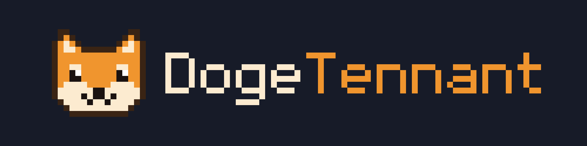

Minecraft plugin developer - Paper, Purpur, Velocity and BungeeCord.

I'm the active developer of a live Minecraft network (Velocity proxy, several servers, one shared
MySQL database) and I build my own plugins: 20 so far, about 150,000 lines of Java, with automatic
tests that run on every change.

**Open for commissions:** custom plugins, fixes and updates for existing plugins, monthly
maintenance. Also open to a full-time role on a Minecraft project or a place in a dev team.
Discord: `DogeTennant`

## Plugins

| Plugin | What it does | Get it |
|--------|--------------|--------|
| [FluxHomes](https://github.com/DogeTennant/FluxHomes) | Modern homes plugin with a GUI, SQLite or MySQL | [BuiltByBit](https://builtbybit.com/resources/fluxhomes.98452/) · [Spigot](https://www.spigotmc.org/resources/fluxhomes.133432/) |
| [dHolograms](https://github.com/DogeTennant/dHolograms) | Lightweight holograms on modern Display entities | GitHub |
| [dPlayerProfiles](https://github.com/DogeTennant/dPlayerProfiles) | Profiles, achievements, badges and paths for player retention | GitHub |
| [dTournaments](https://github.com/DogeTennant/dTournaments) | Fully-featured tournaments for Paper 26.1+ | GitHub |
| [FluxShops](https://github.com/DogeTennant/FluxShops) | Fully GUI-driven chest shops with holograms | GitHub |
| [dWorldManager](https://github.com/DogeTennant/dWorldManager) | Stops items and value leaking out of a persistent world when another world is wiped | GitHub |
| [dSlashServerVelocity](https://github.com/DogeTennant/dSlashServerVelocity) | `/hub` instead of `/server hub` on Velocity, with a login gate | GitHub |
| [dCommandLogInterceptor](https://github.com/DogeTennant/dCommandLogInterceptor) | Keeps `/login` and `/register` passwords out of Velocity's logs | GitHub |
| [dAnnouncements](https://github.com/DogeTennant/dAnnouncements) | Scheduled, eye-catching announcements | GitHub |
| [OneInTheChamberReborn](https://github.com/DogeTennant/OneInTheChamberReborn) | The One in the Chamber minigame, rebuilt | GitHub |
| [FluxForge](https://github.com/DogeTennant/FluxForge) | Industrial tech without mods: energy networks, machines, a jetpack | GitHub |

Also built, not public: block logging with rollbacks, a detection-only anticheat with network-wide
alerts, packet-level vanish for Velocity networks, a battle pass, levelling pets, an RPG system,
NPC vendor shops, 1.8-style PvP and safe random teleport.

## How I build

- **Tests on every change:** JUnit, Mockito, MockBukkit (the whole plugin on a simulated server),
  database tests on SQLite, H2 and a real MySQL (Testcontainers), all in GitHub Actions CI.
- **Storage:** SQLite or MySQL with HikariCP, database work off the main thread, a built-in
  migration command.
- **Configurable:** everything players see is in config and translation files (MiniMessage).
- **Plays well with others:** Vault, PlaceholderAPI, WorldGuard, Residence, MythicMobs, mcMMO, Jobs,
  AuraSkills, Citizens, FancyNpcs and more, all optional.

## Other projects

- [FalloutRadioDiscordMusicBot](https://github.com/DogeTennant/FalloutRadioDiscordMusicBot) - a
  Discord music bot that plays the Fallout radio stations
- [yt-enhanced-search-filters](https://github.com/DogeTennant/yt-enhanced-search-filters) - better
  search filters for YouTube
- [siege-scroll-tracker](https://github.com/DogeTennant/siege-scroll-tracker) - tracks scroll use per
  clan member in Raid: Shadow Legends' Siege mode
